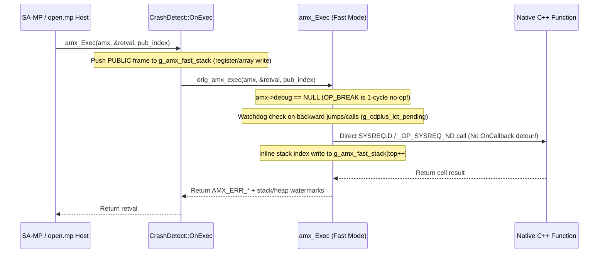

# Zero-Overhead `fast_mode` Architecture

This document explains the internal VM and C++20 runtime mechanics that allow **CrashDetect Plus** to capture full symbolic Pawn and native stack traces in production with near-zero CPU and memory overhead.

---

## 1. The Legacy Bottleneck (Why Classic CrashDetect Was Slow)

When a Pawn script is compiled with `-d3`, the compiler emits an `OP_BREAK` opcode at the start of every statement and appends a symbolic `AMX_DBG` section to the `.amx` file (outside the loaded code/data image).

Classic CrashDetect (`<= 4.22`) incurred runtime overhead on server ticks primarily from:

1. **Per-Statement `OP_BREAK` Hook**: Classic CrashDetect installed `amx->debug = GlobalDebugHook`. Every line of Pawn code executed a C-to-C++ indirect call, looked up the `AMX*` in a `std::map` (`O(log M)` tree walk), saved `last_frame_`, and queried the OS clock for `long_call_time`.
2. **Per-Native Callback Interception**: Hooking `amx->callback` routed every native invocation through `CrashDetect::OnCallback` and heap `std::deque::push_front` allocations.
3. **Linear Symbol Scans**: Looking up lines, files, and function symbols used linear loops over `AMX_DBG` arrays, and `uint16_t` header counters overflowed on large gamemodes (`> 65,535` lines or symbols).

---

## 2. How CrashDetect Plus Achieves Near-Zero Overhead

### A. Preserving `SYSREQ.D` and `_OP_SYSREQ_ND` Direct Dispatch
When `fast_mode` is enabled (the default whenever `trace` is empty), `CrashDetect::ApplyExecutionMode()` **preserves `orig_sysreq_d_`** and leaves `amx->callback` untouched.
- Classic `v8` scripts self-patch `OP_SYSREQ_C` -> `OP_SYSREQ_D` (or `_OP_SYSREQ_D`) and jump straight into native C++ functions.
- Modern `open.mp` Community Compiler (`v9`–`v11`, `-O2`) scripts self-patch `OP_SYSREQ_N` -> `_OP_SYSREQ_ND` and execute macro-opcodes (`OP_PUSH2_C`..`OP_PUSH5_ADR`, `OP_LOAD_BOTH`, `OP_CONST_S`) directly.
- If a crash or `PrintBacktrace()` occurs **inside** a direct `SYSREQ.D` native call, CrashDetect Plus resolves the native's name in `O(1)` average time using a pre-indexed `uintptr_t -> native_index` hash map (`CrashDetect::ResolveNativeIndex`).

### B. Zero-Allocation Unified Call Stack (`g_amx_fast_stack` & `AMXCallStack`)
Instead of allocating `std::deque` heap blocks on every `OnPlayerUpdate` or native call:
- Active public and native frames are recorded in a contiguous static ring/stack (`AMX_FAST_STACK` of 512 frames in `amx.c` and `std::array<AMXCall, 256>` in C++).
- Entering and leaving a native requires **zero heap allocations**, **zero mutex locks**, and **zero C++ virtual dispatches**—just writing 4 scalars into an L1-cache-hot array slot and incrementing an integer index.

### C. Post-Mortem Read-Only Pawn Stack Unwinding
In `fast_mode`, `amx->debug` remains `nullptr`, so `OP_BREAK` executes as a no-op during normal gameplay. When an exception, runtime error, or `GetBacktrace()` occurs:
- `GetAMXStackTrace` constructs a **100% read-only virtual top frame** from `(amx->frm, amx->cip)` and walks the Pawn `FRM` chain (`[prev_frm, return_cip, byte_arg_count, args...]`).
- Unlike legacy CrashDetect—which temporarily mutated `amx->stk` and `amx->frm` to `amx->hea` and broke `CheckStack()` during `AMX_ERR_STACKERR`—CrashDetect Plus **never writes to AMX memory** while unwinding, making it completely safe during stack/heap collisions and OS `SIGSEGV` / Access Violation crashes.

### D. Decoupled Background Watchdog Thread (`g_cdplus_lct_pending`)
Querying `std::chrono::steady_clock` on every Pawn opcode creates register pressure and hurts inner VM loop speed. Moreover, `-d0` scripts contain zero `OP_BREAK` instructions, making legacy CrashDetect completely blind to infinite loops in `-d0` scripts.
- CrashDetect Plus tracks execution duration using a dedicated background watchdog thread that polls execution state once every ~1 ms.
- If a callback exceeds `long_call_time`, the watchdog sets an atomic flag (`g_cdplus_lct_pending = 1`).
- The Pawn VM only reads this flag on backward jumps (`dest <= cip`) and function calls (`CALL` / `CALL.PRI`), requiring **zero dedicated CPU registers** and eliminating all register spills in linear code.
- Infinite `while(true) {}` loops and runaway recursion are caught reliably in **both `-d3` and `-d0`** scripts while keeping Pawn loop performance within <5% of bare open.mp servers!

### E. 1-Cycle MRU `AMXHandler` & Zero `AMX::userdata` Slots
- Pawn's `AMX` struct only provides `4` `userdata` slots (`AMX_USERNUM = 4`), shared across all loaded plugins. CrashDetect Plus uses `amx_SetDefaultExtHooks` so **zero `AMX::userdata` slots are required**.
- Mapping `AMX* -> CrashDetect*` uses a **1-pointer Most-Recently-Used (MRU) cache** backed by `std::unordered_map` (`AMXHandler<CrashDetect>`), turning consecutive callbacks on the main gamemode into a single pointer comparison.

### F. `O(log N)` Pre-Indexed Debug Symbols & `>65,535` Overflow Recovery
At script load (`AMXDebugInfo::Load`), CrashDetect Plus:
- Recovers exact 32-bit line and symbol counts when large gamemodes overflow the 16-bit `AMX_DBG_HDR::lines` or `AMX_DBG_HDR::symbols` fields.
- Builds sorted index tables so file, line, function, and tag lookups run in **`O(log N)` binary search** during crash reporting.
